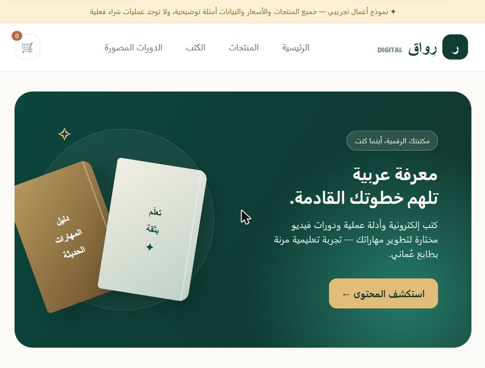
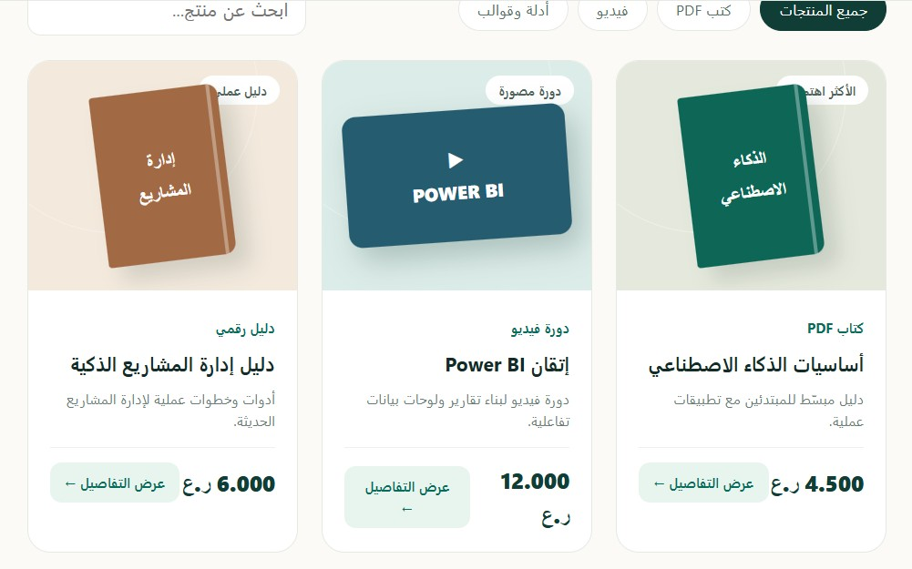

# build-commerce-store

مهارة (Skill) لوكلاء الذكاء الاصطناعي لبناء وتحديث متاجر إلكترونية متكاملة: المنتجات الرقمية والمادية، الدفع، Supabase، لوحة الإدارة، التحليلات، النسخ الاحتياطي وفحص الأمان — بالعربية والإنجليزية.

An agent skill for building and updating complete ecommerce stores (digital/physical products, checkout, Supabase, admin dashboards, analytics, backups and security review), Arabic RTL and English.

## أمثلة من المخرجات | Examples

مخرجات فعلية من تجربة المهارة بطلب: «متجر عُماني صغير لكتب PDF عربية ودورات فيديو بالريال العُماني» — معاينة تفاعلية ببيانات تجريبية.

Real output from testing the skill: a demo storefront for Arabic PDF books and training videos (OMR), with clearly labeled sample data.

| Home | Product cards | Product detail |
|---|---|---|
|  |  |  |

## Structure
- `SKILL.md` — main instructions
- `references/` — design, commerce controls, security & operations
- `agents/openai.yaml` — display metadata
- `assets/icon.svg`

## Install
Copy the `build-commerce-store` folder into your skills directory (e.g. `~/.claude/skills/`), or download the repo as ZIP and upload it as a skill.

By [AIOMAN](https://github.com/AIOMAN-OM)

## License

MIT — see [LICENSE](LICENSE).
